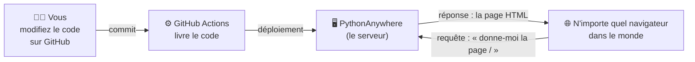

# 🌍 Atelier « Découvrir le Web »

Bienvenue ! 👋

Chaque jour, vous tapez des adresses dans un navigateur et des pages s'affichent. **Mais que se passe-t-il vraiment entre le moment où vous appuyez sur Entrée et celui où la page apparaît ?**

Dans cet atelier, vous allez **mettre en ligne votre propre petit site Web** puis le faire évoluer, pas à pas, pour découvrir comment fonctionne le Web : les URL, le HTML, le CSS, les requêtes HTTP, les formulaires, les codes d'erreur, les API…

> 🎯 **L'objectif n'est pas de construire une application**, mais de **comprendre** ce qui se passe derrière une page Web. Chaque exercice est court (10 à 20 minutes) et vous fait découvrir **une seule notion**.

**Prérequis :** aucun ! Savoir lire quelques lignes de Python aide, mais tout est expliqué.
**Ce qu'il vous faut :** un navigateur (Chrome, Firefox ou Edge), un compte GitHub et une adresse e-mail.

---

## 🗺️ Comment ça marche ?

Vous allez travailler avec trois outils :

| Outil | Son rôle | Analogie |
|---|---|---|
| **GitHub** | Stocker votre code et garder l'historique de vos modifications | Votre classeur de travail |
| **GitHub Actions** | Envoyer automatiquement votre code sur le serveur à chaque modification | Le livreur |
| **PythonAnywhere** | Le serveur qui héberge votre site et le rend accessible à tout le monde | La boutique ouverte au public |

**La boucle de travail** que vous répéterez à chaque exercice :

1. ✏️ Vous modifiez un fichier **directement sur le site de GitHub** (icône crayon ✏️), puis vous cliquez sur **Commit changes**.
2. ⏳ Vous patientez ~30 secondes : l'onglet **Actions** de votre dépôt affiche une pastille jaune 🟡, puis verte ✅.
3. 🔄 Vous rechargez votre site dans le navigateur : votre modification est en ligne !

---

## 🧩 Séquence 1 : Créer votre dépôt GitHub

**Objectif :** obtenir votre propre copie de l'atelier
**Difficulté :** très facile (~10 minutes)

1. Si vous n'en avez pas encore, créez un compte sur **https://github.com**.
2. En haut de cette page, cliquez sur le bouton vert **Use this template** → **Create a new repository**.
3. Donnez un nom à votre dépôt (par exemple `mon-premier-site`), laissez-le en **Public**, puis cliquez sur **Create repository**.

Vous avez maintenant **votre propre dépôt**, indépendant de celui de l'enseignant. C'est lui que vous modifierez pendant tout l'atelier.

> ⚠️ Dans l'onglet **Actions** de votre nouveau dépôt, vous verrez peut-être déjà une croix rouge ❌. **C'est normal !** Le robot a essayé de déployer votre site, mais il ne sait pas encore où l'envoyer. On règle ça dans la séquence 3.

---

## 🧩 Séquence 2 : Créer votre site chez PythonAnywhere

**Objectif :** obtenir un serveur gratuit, accessible depuis Internet
**Difficulté :** facile (~10 minutes)

> ⚠️ **Important : laissez le site PythonAnywhere en anglais !** Si votre navigateur vous propose de traduire la page en français, **refusez** (ou désactivez la traduction automatique pour ce site). Les consignes ci-dessous utilisent les noms anglais des boutons et des menus (*Web*, *Add a new web app*, *Account*…) : une fois traduits, vous ne les retrouveriez plus. La traduction peut aussi modifier les chemins de fichiers et les noms d'utilisateur affichés, et vous recopieriez alors de mauvaises valeurs dans vos secrets.

1. Rendez-vous sur **<a href="https://www.pythonanywhere.com" target="_blank">https://www.pythonanywhere.com</a>** (astuce : **Ctrl + clic**, ou **Cmd + clic** sur Mac, pour l'ouvrir dans un nouvel onglet et garder ces consignes sous les yeux) et créez un compte gratuit (**Pricing & signup** → **Create a Beginner account**).
   👉 Notez bien votre **nom d'utilisateur** (*username*), vous en aurez besoin.
2. Une fois connecté, ouvrez l'onglet **Web** (en haut à droite) puis cliquez sur **Add a new web app**.
3. Suivez l'assistant :
   - **Next** (le nom de domaine proposé est `votre-username.pythonanywhere.com`)
   - Choisissez le framework **Flask**
   - Choisissez la version de Python la plus récente
   - Laissez le chemin proposé tel quel : `/home/votre-username/mysite/flask_app.py` → **Next**
4. Cliquez sur le lien de votre site (`https://votre-username.pythonanywhere.com`) : vous devez voir *« Hello from Flask! »*. 🎉
   Votre serveur fonctionne ! Pour l'instant il affiche un code d'exemple, pas encore le vôtre.
5. Dernière chose : créez un **jeton d'API** (une sorte de mot de passe pour le robot de GitHub) :
   menu **Account** → onglet **API Token** → **Create a new API token**. Gardez cette page ouverte.

---

## 🧩 Séquence 3 : Relier GitHub et PythonAnywhere (les secrets)

**Objectif :** permettre à GitHub de livrer automatiquement votre code sur PythonAnywhere
**Difficulté :** moyenne (~15 minutes)

Dans votre dépôt se trouve un fichier `.github/workflows/deploy-pythonanywhere.yml`. C'est une **GitHub Action** : un petit programme qui s'exécute **automatiquement à chaque modification** (*commit*) de votre code, et qui envoie vos fichiers sur PythonAnywhere. On appelle ça du **déploiement continu**.

Pour fonctionner, ce robot a besoin de votre nom d'utilisateur et de votre jeton d'API. Mais votre dépôt est **public** : il ne faut surtout pas écrire ces informations dans le code ! On les range donc dans des **secrets**, qui restent invisibles pour les visiteurs.

Dans votre dépôt GitHub : **Settings → Secrets and variables → Actions → New repository secret**, puis créez ces **4 secrets** (attention aux majuscules) :

| Nom du secret | Valeur | Exemple |
|---|---|---|
| `PA_USERNAME` | votre nom d'utilisateur PythonAnywhere | `alice42` |
| `PA_TOKEN` | votre jeton d'API (séquence 2, étape 5) | `3f9a...` |
| `PA_TARGET_DIR` | le dossier de votre site (onglet **Web** → *Source code*) | `/home/alice42/mysite` |
| `PA_WEBAPP_DOMAIN` | l'adresse de votre site, **sans** `https://` | `alice42.pythonanywhere.com` |

**Lancer le premier déploiement :** onglet **Actions** de votre dépôt → cliquez sur **Deploy to PythonAnywhere** dans la liste de gauche → bouton **Run workflow** → **Run workflow**.

✅ **C'est réussi si** la pastille devient verte et que votre site affiche maintenant *« Bonjour le monde ! (Flask on PythonAnywhere) »*.
❌ **Croix rouge ?** Cliquez dessus pour lire le message d'erreur : il vous indique souvent quel secret est manquant ou mal écrit. Voir aussi la section 🧠 Dépannage en bas de page.

---

## 🧩 Séquence 4 : Les exercices

**Objectif :** découvrir le fonctionnement du Web, une notion à la fois
**Difficulté :** progressive (~3 heures au total)

Faites les exercices **dans l'ordre** : chacun s'appuie sur le précédent. Chaque exercice contient :
- 🎯 ce que vous allez découvrir,
- 🛠️ ce qu'il faut faire,
- 👀 ce qu'il faut observer,
- 📝 des questions auxquelles répondre dans le fichier [`CARNET.md`](CARNET.md) de votre dépôt.

| # | Exercice | Notion découverte | Durée |
|---|---|---|---|
| | **🟢 Niveau 1 — Publier** | | |
| 1 | [Mon premier déploiement](exercices/01-premier-deploiement.md) | Code → serveur → navigateur | 10 min |
| 2 | [Les URL et les routes](exercices/02-urls-et-routes.md) | Une adresse = une page | 15 min |
| | **🔵 Niveau 2 — Afficher** | | |
| 3 | [Le langage HTML](exercices/03-html.md) | Le navigateur interprète du texte | 15 min |
| 4 | [Les templates](exercices/04-templates.md) | Séparer le code et la présentation | 15 min |
| 5 | [Le CSS et les liens](exercices/05-css-et-liens.md) | Mise en forme et navigation | 20 min |
| | **🟣 Niveau 3 — Échanger** | | |
| 6 | [Espionner le navigateur](exercices/06-outils-developpement.md) | Requêtes et réponses HTTP | 15 min |
| 7 | [Envoyer des informations dans l'URL](exercices/07-parametres-url.md) | Paramètres d'URL | 15 min |
| 8 | [Les formulaires](exercices/08-formulaires.md) | GET et POST | 20 min |
| | **🔴 Niveau 4 — Dans les coulisses** | | |
| 9 | [Les codes de statut](exercices/09-codes-de-statut.md) | 200, 302, 403, 404… | 15 min |
| 10 | [Ce que le serveur sait de vous](exercices/10-ce-que-le-serveur-sait.md) | En-têtes HTTP et journaux | 15 min |
| 11 | [Le Web des machines](exercices/11-api-json.md) | API, JSON et JavaScript | 20 min |

> 💡 **Astuce :** pour modifier un fichier sur GitHub, ouvrez-le puis cliquez sur le crayon ✏️. Pour **créer** un fichier (même dans un nouveau dossier), utilisez **Add file → Create new file** et tapez par exemple `templates/accueil.html` : le `/` crée le dossier automatiquement.

---

## 🧠 Dépannage

Vous allez faire des erreurs : **c'est normal, et c'est comme ça qu'on apprend !** Une faute de frappe, une parenthèse oubliée, une mauvaise indentation… et le site affiche une erreur.

**1. Le robot GitHub a une croix rouge ❌**
Onglet **Actions** → cliquez sur l'exécution en rouge → lisez le message. Le plus souvent : un secret manquant ou mal recopié.

**2. Le site affiche « Something went wrong » ou une erreur 500**
Votre code Python contient probablement une erreur. Allez lire les **journaux** (*logs*) de votre serveur : sur PythonAnywhere, onglet **Web** → section **Log files** :

| Journal | Ce qu'il contient |
|---|---|
| **Error log** (`votre-username.pythonanywhere.com.error.log`) | Les erreurs Python. **Lisez la fin du fichier** : la dernière ligne indique l'erreur, et quelques lignes au-dessus le numéro de ligne fautif. |
| **Access log** (`votre-username.pythonanywhere.com.access.log`) | Toutes les visites reçues par votre site |
| **Server log** (`votre-username.pythonanywhere.com.server.log`) | Les démarrages et arrêts du serveur |

**3. Ma modification n'apparaît pas**
- La pastille de l'onglet **Actions** est-elle bien verte ?
- Forcez le rechargement de la page : **Ctrl + F5** (ou **Cmd + Shift + R** sur Mac). Le navigateur garde parfois une ancienne version en mémoire (le *cache*), surtout pour les fichiers CSS.

**4. Mon site a disparu au bout de quelques semaines**
Les comptes gratuits PythonAnywhere doivent être réactivés régulièrement : onglet **Web** → bouton **Run until 3 months from today**.

**Erreurs Python fréquentes :**

| Message | Cause probable |
|---|---|
| `IndentationError` | Les espaces en début de ligne ne sont pas alignés |
| `SyntaxError` | Une parenthèse, un guillemet ou deux-points `:` oublié |
| `NameError: name 'xxx' is not defined` | Une faute de frappe, ou un `import` oublié |
| `TemplateNotFound` | Le fichier HTML n'est pas dans le dossier `templates/` ou son nom est mal écrit |
| `AssertionError: View function mapping is overwriting...` | Deux fonctions portent le même nom dans `flask_app.py` |
